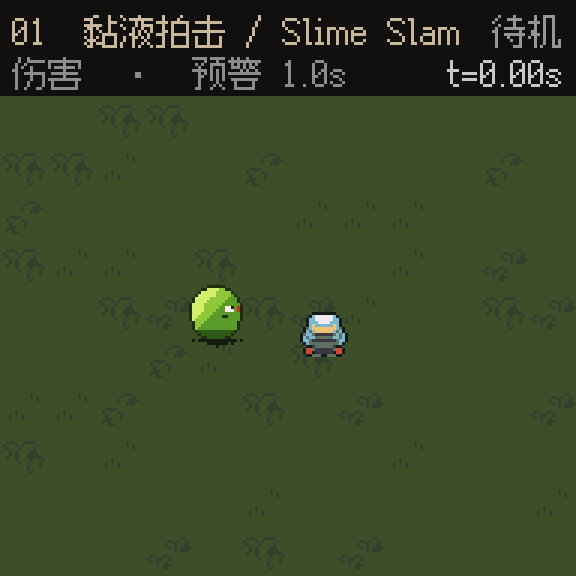
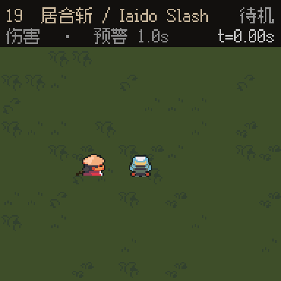
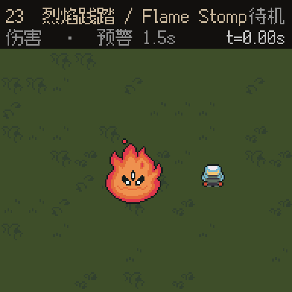

# pixel-vfx-research-workflow

**An Agent Skill for researching published attack VFX cases first, then redrawing 2D pixel skill effects.**

[中文说明](README.zh-CN.md)

Use this when a warning (telegraph) and hitbox are already fair, but the **hit animation** looks timid, technically correct but not bold, or unlike the move it is supposed to be. The loop is: restate general drawing rules, collect 8–12 **cited** cases for that move type, write a timeline scheme, **wait for approval before rendering**, then draw with an independent script (keeping older previews) and self-check keyframes against the cases.

It is a companion to [pixel-attack-telegraph](https://github.com/Hoidya/pixel-attack-telegraph), which covers “warning == hitbox”. This skill covers **how the attack should look and feel** once that contract is in place.

Give the folder to your coding agent (Codex, Claude Code, Cursor, …) and ask it to follow [SKILL.md](SKILL.md).

## The six steps

1. **Restate the general rules** — large, recognizable main shapes; uneven timing (1–3 action frames, 8–15 frames of dissipate); hit and hitstop freeze the most exaggerated picture; few color ramps with a white core and a dark outer ring; layered stack; character poses as the skeleton; light / mid / heavy tiers. The brightest solid core is the hitbox. See [rules.md](rules.md).
2. **Collect 8–12 specific cases** for this move type, each with a real URL you actually opened and a one-line drawing note. Start from the filled tables in [case-template.md](case-template.md) (iaido slash, ground-slam + fire, slime slap).
3. **Write a timeline scheme** with [scheme-template.md](scheme-template.md), and contrast it with the previous version’s problems.
4. **Wait for the user to confirm** the scheme before touching pictures.
5. **Render** — one independent script per move, work in parallel if several moves are in flight, keep older previews, and keep the pixel contract (integer pixels, nearest-neighbour, dither instead of alpha; telegraph pixels still equal the hitbox).
6. **Self-check** keyframes against the cases and [checklist.md](checklist.md). Iterate once if a picture is still timid. Ship with known limits stated honestly.

Do not copy another artist’s frames or asset-pack art into a deliverable. Cases are for structure, timing, and shape language only. Use generic public example names (a slime, a samurai, a fire giant, a wooden dummy).

## Example previews

Original later-pass GIFs from this workflow. Characters are CC0 Ninja Adventure; the attack shapes are original.

| Slime slam (light / mid) | Iaido slash (climax) | Flame stomp (heavy) |
|---|---|---|
|  |  |  |

Specs used here: 576×576, 30 fps, looping. The red warning still matches the hitbox; overflow VFX may extend past it. Scripts and notes: [examples/](examples/).

## What’s in the repo

| Path | What |
|---|---|
| [SKILL.md](SKILL.md) | the agent workflow (frontmatter `name` / `description`, six steps, privacy rules) |
| [rules.md](rules.md) | general drawing rules (English + 中文) |
| [case-template.md](case-template.md) | blank case card + three filled type tables with real URLs |
| [scheme-template.md](scheme-template.md) | timeline scheme template |
| [checklist.md](checklist.md) | keyframe self-check list |
| [examples/](examples/) | preview GIFs and reference renderer scripts |

## Related: attack warnings

For designing the warning itself (shape, style, duration, cadence, budget) use **[Hoidya/pixel-attack-telegraph](https://github.com/Hoidya/pixel-attack-telegraph)**.

## License

Code and docs: [MIT](LICENSE). Character and grass tiles in the example GIFs: Ninja Adventure by Pixel-boy & AAA, CC0 — see [CREDITS.md](CREDITS.md).
