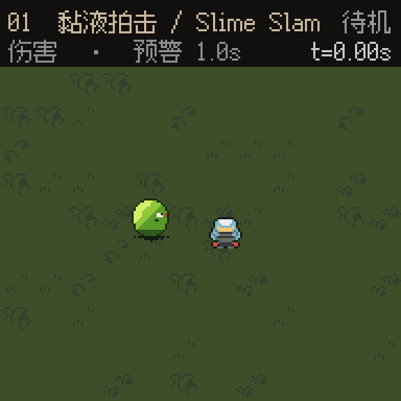
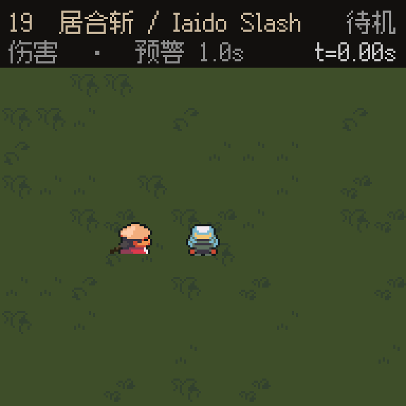
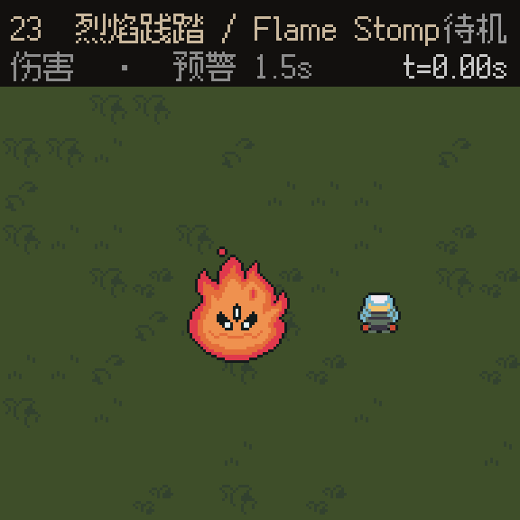

# pixel-vfx-research-workflow

**一套 Agent Skill：先研究已发表的出手特效案例，再重画 2D 像素技能动画。**

[English](README.md)

用在预警（telegraph）和判定已经公平，但**命中动画**看起来胆小、技术上正确但不像那一招的时候。流程是：先确认项目案例画风，为这一类招式搜集 8–12 个**可核对出处**的案例，写好按时间轴分段的方案，**等确认后再渲图**，然后同时检查关键帧和连续动作。

本仓库已把 [patch-gg/pixelfx](https://github.com/patch-gg/pixelfx) 的 **244 个可编辑效果案例**、核心代码与预览/导出工具放入 [vendor/pixelfx/](vendor/pixelfx/README.md)。可检索案例、渲染预览、观察施法者与受击者的完整动作、按选定画风修改效果代码，再检查并导出。它用于离线制作，不是游戏必装的运行时依赖。见 [pixelfx-method.md](pixelfx-method.md)。

它是 [pixel-attack-telegraph](https://github.com/Hoidya/pixel-attack-telegraph) 的配套技能。预警仓库管「预警就是判定」；本仓库管判定已经正确之后，**这一招应该长什么样、节奏该怎么走**。

把整个文件夹交给编码助手（Codex、Claude Code、Cursor 等），让它按 [SKILL.md](SKILL.md) 做。

## 六步流程

1. **确认画风并写规则** — 尚未指定时先问用户案例画风，记录像素尺寸、配色、轮廓、视角和动作语言；保持可辨认的主形、清楚的节奏、角色与特效联动，以及符合招式档位的反馈。见 [rules.md](rules.md)。
2. **按招式类型搜 8–12 个具体案例**，记录可核对的来源和一行画法特点；同时检索已内置的 244 个 pixelfx 案例与其他公开案例，按画风适配度筛选。见 [case-template.md](case-template.md)。
3. **写时间轴分段的画法方案**（模板：[scheme-template.md](scheme-template.md)），并对照旧版指出问题。
4. **等用户确认方案后才动图**。
5. **作画或修改效果代码** — 改写内置 `src/fx/` 案例或新建效果，保留旧版与项目像素规范；同时预览关键帧和包含施法者、目标的连续动作。
6. **在原生尺寸下对照画风与案例自查**（清单：[checklist.md](checklist.md)）。修正最明显的问题后重新预览，适用时进入游戏场景检查；交付时写明已知不足。

不要把别人的帧、精灵或素材包画直接贴进成品。案例只用来学结构、节奏和形。示例角色用通用名（史莱姆、武士、火焰巨人、木头人）。

## 试用内置案例

在 `vendor/pixelfx` 目录运行（需要 Node 18+）：

```sh
node tools/list.mjs slash
node tools/render.mjs melee/sword-slash --all
node tools/act.mjs melee/sword-slash
node tools/check.mjs melee/sword-slash
node tools/render.mjs melee/sword-slash --sheet
```

案例代码在 `vendor/pixelfx/src/fx/melee/sword-slash.js`。看过案例后，按选定画风修改副本或新建效果；改完重新渲染、检查。最后一条命令导出透明 PNG 精灵表和 JSON，进入目标游戏后仍须验证尺寸、轴心、播放节奏和画风。生成的 `records/` 已忽略。完整操作见 [pixelfx-method.md](pixelfx-method.md)。

## 示例预览

本流程一轮迭代后的原创预览 GIF。角色来自 CC0 的 Ninja Adventure；攻击形是原创绘制。

| 黏液拍击（轻 / 中） | 拔刀斩（高潮档） | 烈焰践踏（重） |
|---|---|---|
|  |  |  |

规格：576×576，30 fps，循环。红色预警仍与判定重合；特效可以画出判定外。脚本与说明见 [examples/](examples/)。

## 包里有什么

| 路径 | 内容 |
|---|---|
| [SKILL.md](SKILL.md) | 助手流程（frontmatter 的 `name` / `description`、六步、隐私规则） |
| [rules.md](rules.md) | 通用画法规则（中英对照） |
| [case-template.md](case-template.md) | 空白案例卡 + 三类已填表（含真实链接） |
| [scheme-template.md](scheme-template.md) | 时间轴方案模板 |
| [checklist.md](checklist.md) | 关键帧自查清单 |
| [pixelfx-method.md](pixelfx-method.md) | 内置 pixelfx 的检索、改代码、预览和导出流程 |
| [vendor/pixelfx/](vendor/pixelfx/README.md) | 固定上游版本、保留授权说明的 244 个可编辑案例与工具 |
| [examples/](examples/) | 预览 GIF 与参考渲染脚本 |

## 相关：攻击预警

设计预警本身（形状、画法、时长、节奏、攻击名额）请用 **[Hoidya/pixel-attack-telegraph](https://github.com/Hoidya/pixel-attack-telegraph)**。

## 许可

代码和文档：[MIT](LICENSE)。示例 GIF 中的角色与草地：Ninja Adventure（作者 Pixel-boy 和 AAA），CC0，见 [CREDITS.md](CREDITS.md)。
